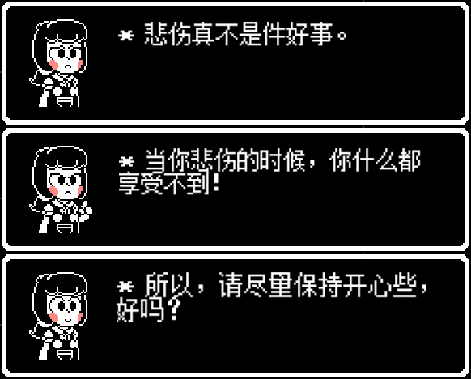
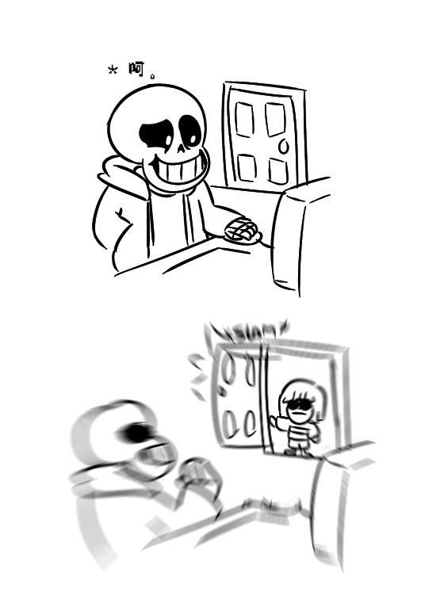
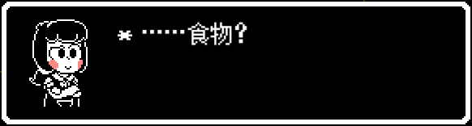
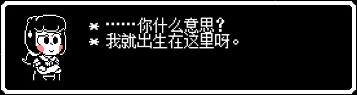
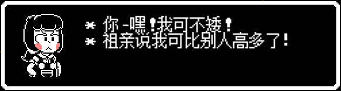
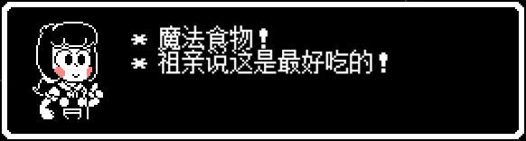

# [Undertale AU系列]Omega 时间线: Poppy的故事——第一幕提问(1)

> 原文: https://www.bilibili.com/read/cv53696266

#  [第一幕提问时间轴](第一幕提问时间轴.md)

# **前言**

本文译自Omega Timeline: Poppy's Story官方Tumblr上发布的问答内容，具体链接请看每段问答部分的顶部部分。

原文均发布于2019年8月17日。

# **正文**

## **1.**

原链接：[https://ut-poppy-askblog.tumblr.com/post/187074677362/hello-poppy-what-do-you-think-of-sadness#notes](https://ut-poppy-askblog.tumblr.com/post/187074677362/hello-poppy-what-do-you-think-of-sadness#notes)

国内可访问链接：[https://priviblur.canine.tools/ut-poppy-askblog/post/187074677362/hello-poppy-what-do-you-think-of-sadness#notes](https://priviblur.canine.tools/ut-poppy-askblog/post/187074677362/hello-poppy-what-do-you-think-of-sadness#notes)

> 匿名用户问道：

> “嗨，Poppy，你对悲伤有什么看法？”

## **2.**

原链接：[https://ut-poppy-askblog.tumblr.com/post/187075171707/do-you-wanna-have-a-bad-time#notes](https://ut-poppy-askblog.tumblr.com/post/187075171707/do-you-wanna-have-a-bad-time#notes)

国内可访问链接：[https://priviblur.canine.tools/ut-poppy-askblog/post/187075171707/do-you-wanna-have-a-bad-time#notes](https://priviblur.canine.tools/ut-poppy-askblog/post/187075171707/do-you-wanna-have-a-bad-time#notes)

> 匿名用户问道：

> “你是不是想吃点苦头？”

## **3.**

原链接：[https://ut-poppy-askblog.tumblr.com/post/187076027182/what-do-you-eat#notes](https://ut-poppy-askblog.tumblr.com/post/187076027182/what-do-you-eat#notes)

国内可访问链接：[https://priviblur.canine.tools/ut-poppy-askblog/post/187076027182/what-do-you-eat#notes](https://priviblur.canine.tools/ut-poppy-askblog/post/187076027182/what-do-you-eat#notes)

> unoriginal64问道：

> “你吃什么？”【是啊，吃什么（doge）】

## **4.**

原链接：[https://ut-poppy-askblog.tumblr.com/post/187076076637/sohow-did-you-ended-up-in-ot#notes](https://ut-poppy-askblog.tumblr.com/post/187076076637/sohow-did-you-ended-up-in-ot#notes)

国内可访问链接：[https://priviblur.canine.tools/ut-poppy-askblog/post/187076076637/sohow-did-you-ended-up-in-ot#notes](https://priviblur.canine.tools/ut-poppy-askblog/post/187076076637/sohow-did-you-ended-up-in-ot#notes)

> subna03 问道：

> “所以，你最终是如何进入 OT 的呢？”

> 【编者注：作者在该问答帖子后附注“（作者题外话①：<u>请在提问前先阅读常见问题解答！</u>）”，其中下划线部分是个链接，但由于转到的链接页面不存在，也无法找到相对应的链接内容，因此无法在这里给出内容，初步判断该链接等同于现在au的faq页面，后续将会翻译此部分并发出专栏，因此此处就先空着不给出链接。

> 另外subna03后续评论回应道：

> "(oh sorry, i read it, but I mean another thing, how did the baby ended up in the OT, like, his mother enter there and stuff happen? Well,is understable if they doesn't know anyways)"

> “（哦，抱歉，我读过相关内容了，但我的意思是另一件事：这个孩子究竟是怎么出现在OT的呢？比如，他的母亲是怎么进入OT的，然后又发生了什么事情？嗯，如果ta根本不知道这些情况的话，这也难怪。）”②】

## **5.**

原链接：[https://ut-poppy-askblog.tumblr.com/187076172552/smol#notes](https://ut-poppy-askblog.tumblr.com/187076172552/smol#notes)

国内可访问链接：[https://priviblur.canine.tools/ut-poppy-askblog/187076172552/smol#notes](https://priviblur.canine.tools/ut-poppy-askblog/187076172552/smol#notes)

> 匿名用户问道：

> “小不点。”③

## **6.**

原链接：[https://ut-poppy-askblog.tumblr.com/187077060827/what-kind-of-food-do-you-eat#notes](https://ut-poppy-askblog.tumblr.com/187077060827/what-kind-of-food-do-you-eat#notes)

国内可访问链接：[https://priviblur.canine.tools/ut-poppy-askblog/187077060827/what-kind-of-food-do-you-eat#notes](https://priviblur.canine.tools/ut-poppy-askblog/187077060827/what-kind-of-food-do-you-eat#notes)

> unoriginal64问道：

> “你平时吃什么食物？”

## **7.**

原链接：[https://ut-poppy-askblog.tumblr.com/post/187078854837/what-is-living-in-the-ot-like#notes](https://ut-poppy-askblog.tumblr.com/post/187078854837/what-is-living-in-the-ot-like#notes)

国内可访问链接：[https://priviblur.canine.tools/ut-poppy-askblog/post/187078854837/what-is-living-in-the-ot-like#notes](https://priviblur.canine.tools/ut-poppy-askblog/post/187078854837/what-is-living-in-the-ot-like#notes)

> 匿名用户问道：

> “在OT生活是怎样的？”

# **译注**

①原文是ooc，即“Out Of Character”，原意为“不符合角色性格设定”，这里综合语境翻译为“作者题外话”（虽然我感觉还是不太合适），如对此处翻译有意见可指出

②原文这里用his而非her，可能是因为此时subna03当时还不知道Poppy是个女孩，此处为表示对subna03的尊重，保留原文不改。

③原文是Smol，是“small”的一种诙谐或俚语形式，这里综合语境翻为小不点。

 [下一页（2019年8月23日的问答内容）](20190823.md)