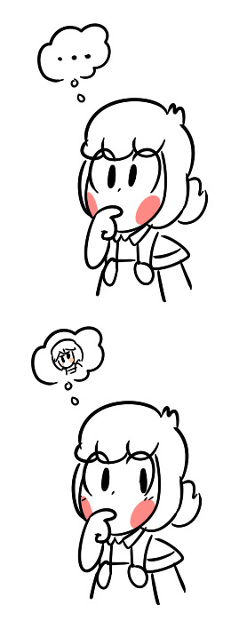
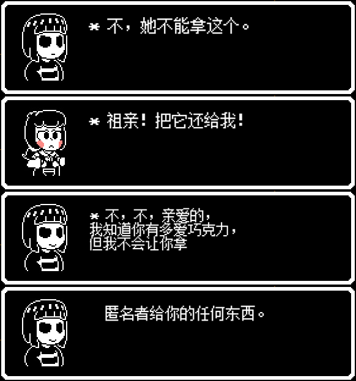
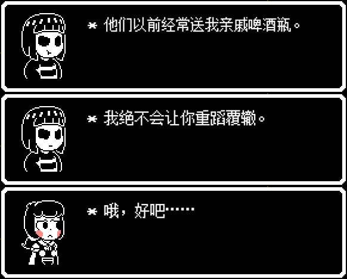
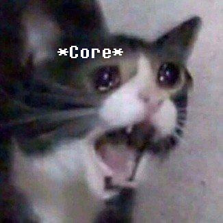
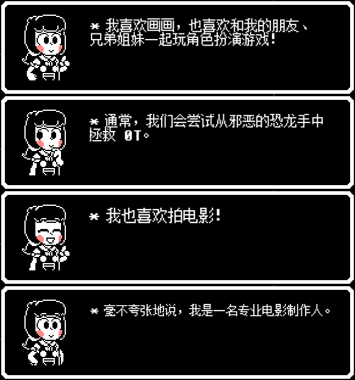
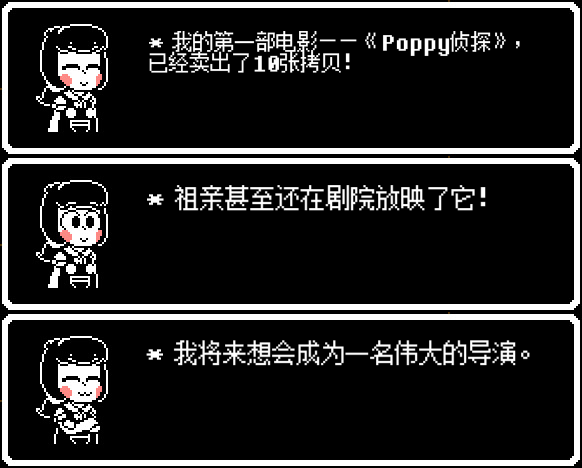

# [Undertale AU系列]Omega 时间线: Poppy的故事——第一幕提问(2)

> 原文: https://www.bilibili.com/read/cv53696371

 [第一章提问时间轴](第一幕提问时间轴.md)

 [上一页](20190817.md)

# **前言**

本文译自Omega Timeline: Poppy's Story官方Tumblr上发布的问答内容，具体链接请看每段问答部分的顶部部分。

原文均发布于2019年8月23日。

# **正文**

## **1.**

原链接：[https://ut-poppy-askblog.tumblr.com/post/187212324937/poppy-whats-the-first-thing-you-think-of-when-it#notes](https://ut-poppy-askblog.tumblr.com/post/187212324937/poppy-whats-the-first-thing-you-think-of-when-it#notes)

国内可访问链接：[https://priviblur.canine.tools/ut-poppy-askblog/187212324937/poppy-whats-the-first-thing-you-think-of-when-it#notes](https://priviblur.canine.tools/ut-poppy-askblog/187212324937/poppy-whats-the-first-thing-you-think-of-when-it#notes)

> trashmoonthingy问

> “Poppy，一想到爱，你首先会想到什么？”

## **2.**

原链接：[https://ut-poppy-askblog.tumblr.com/post/187213343562/hands-poppy-normal-chocolate-you-need-this#notes](https://ut-poppy-askblog.tumblr.com/post/187213343562/hands-poppy-normal-chocolate-you-need-this#notes)

国内可访问链接：[https://priviblur.canine.tools/ut-poppy-askblog/post/187213343562/hands-poppy-normal-chocolate-you-need-this#notes](https://priviblur.canine.tools/ut-poppy-askblog/post/187213343562/hands-poppy-normal-chocolate-you-need-this#notes)

> 匿名用户问道：

> *给Poppy递上一块普通的巧克力*你需要这个。

## **3.**

原链接：[https://ut-poppy-askblog.tumblr.com/post/187213556422/hands-you-a-minecraft-pikachu-hands-you-a#notes](https://ut-poppy-askblog.tumblr.com/post/187213556422/hands-you-a-minecraft-pikachu-hands-you-a#notes)

国内可访问链接：[https://priviblur.canine.tools/ut-poppy-askblog/post/187213556422/hands-you-a-minecraft-pikachu-hands-you-a#notes](https://priviblur.canine.tools/ut-poppy-askblog/post/187213556422/hands-you-a-minecraft-pikachu-hands-you-a#notes)

> dastardlydeacon问道：

> *递给你一只《我的世界》皮卡丘* *递给你一只《我的世界》皮卡丘* *递给你一只《我的世界》皮卡丘*（此处省略不知多少个字）**①*

## **4.**

原链接：[https://ut-poppy-askblog.tumblr.com/post/187213763182/whats-your-favorite-thing-to-do#notes](https://ut-poppy-askblog.tumblr.com/post/187213763182/whats-your-favorite-thing-to-do#notes)

国内可访问链接：[https://priviblur.pussthecat.org/ut-poppy-askblog/post/187213763182/whats-your-favorite-thing-to-do#notes](https://priviblur.pussthecat.org/ut-poppy-askblog/post/187213763182/whats-your-favorite-thing-to-do#notes)

> 匿名用户问道：

> “你最喜欢做什么？”

# **译注**

①原文中最后一个“*hands you a minecraft pikachu *”可能因为字数太过于长了因此被截断，变成“*hands you a minecr”