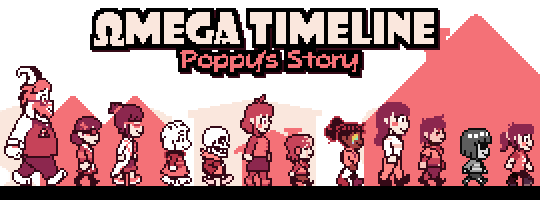

# Omega Timeline : Poppy's Story（《Omega时间线 ： Poppy的故事》）镜像转载项目
 *（图片和原au by FmsDraws）*

欢迎您，潜在的读者，来到本项目！

这个项目旨在让中国大陆的Undertale玩家无需科学上网也能阅读Omega Timeline : Poppy's Story（《Omega时间线 ： Poppy的故事》）这个AU。

[正式阅读](简介.md) | [转载翻译序](转载翻译序.md) | [转载翻译FAQ](#转载翻译FAQ)
## AU介绍
详情请见[这个视频](https://www.bilibili.com/video/BV1zATt68EJj)或[这个部分](简介.md#什么是《Omega时间线：Poppy的故事》？)

## 阅读方法
### 1.在线阅读（推荐）
直接访问以下网站即可：[https://lmlanmei64.de5.net/ut-poppy-askblog-cn](https://lmlanmei64.de5.net/ut-poppy-askblog-cn/)

### 2.本地阅读
使用git命令行克隆该仓库即可：

外网推荐使用：`git clone https://github.com/LmLanmei64/ut-poppy-askblog-cn` 或 `git clone git@github.com:Lmlanmei64/ut-poppy-askblog-cn`

中国大陆推荐使用：`git clone https://v4.gh-proxy.org/github.com/LmLanmei64/ut-poppy-askblog-cn`
若用git gui客户端则需将仓库url填入本仓库url即可

## 转载翻译FAQ
（这里是我自己认为可能被问到的，可能不够齐全，如另有疑问请提交issues）

Q:我能不能为这个AU的翻译做点什么？

A:当然可以！正如我在转载翻译序所说的，我本人的能力比较弱，翻译水平可能无法令人满意，所以我很乐意接受帮助，只需要给这个项目提交PR即可。不过本人只在周末或节假日有空，因此一时半会不能确认是否要提交，请耐心等待