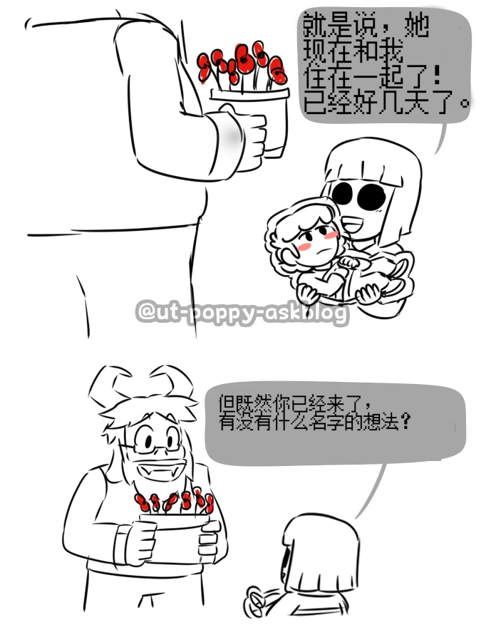
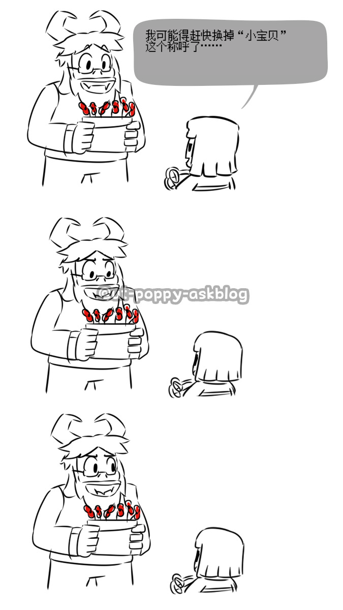

# [Undertale AU系列]Omega时间线：Poppy的故事 - Mr. Asgore给Poppy取名

> b站专栏版: https://www.bilibili.com/read/cv52736928

# **前言**

本文译自Omega Timeline: Poppy's Story官方Tumblr上发布的漫画，[https://ut-poppy-askblog.tumblr.com/654359974635552768/hey-poppy-how-was-your-name-chosen](https://ut-poppy-askblog.tumblr.com/654359974635552768/hey-poppy-how-was-your-name-chosen)

（无法科学上网的请用该链接，国内可正常访问：“[https://priviblur.pussthecat.org/ut-poppy-askblog/654359974635552768/hey-poppy-how-was-your-name-chosen”）](https://priviblur.pussthecat.org/ut-poppy-askblog/654359974635552768/hey-poppy-how-was-your-name-chosen”）)

原文发布于2021年6月18日。

# **正文**

> 匿名用户问道：

> “嘿，Poppy，你的名字是怎么取的？”

回答如图（大部分翻译来自▶ [@殉道寻路 的专栏的一(1)](https://www.bilibili.com/opus/933227618165063696)）：

