# [Undertale AU系列]Omega时间线: Poppy的故事 - Poppy的诞生

> B站专栏版: https://www.bilibili.com/read/cv52734799

# **前言**

本文分为两部分：一部分为tumblr中作者的话，一部分为以存在imgur里的图片呈现的剧情，分别译自Omega Timeline: Poppy's Story官方Tumblr上发布的内容（[https://www.tumblr.com/ut-poppy-askblog/619493206764240897/in-which-poppy-is-conceived-the-comic-can-be-found?source=share）](https://www.tumblr.com/ut-poppy-askblog/619493206764240897/in-which-poppy-is-conceived-the-comic-can-be-found?source=share<u></u>）)与imgur里的图片（[https://imgur.com/a/undertale-au-omega-timeline-poppys-story-poppys-origins-8nE0ciI](https://imgur.com/a/undertale-au-omega-timeline-poppys-story-poppys-origins-8nE0ciI)<u></u>）。

（值得注意的是：虽然tumblr和imgur无法直接访问，但是在github开源项目开发者syeopite的开源项目priviblur和codeberg开源项目开发者3np的开源项目rimgo的帮助下，国内也可以正常访问tumblr和imgur。无法科学上网的请用这些链接，国内可正常访问：“

[https://priviblur.pussthecat.org/ut-poppy-askblog/619493206764240897/in-which-poppy-is-conceived-the-comic-can-be-found?source=share](https://priviblur.pussthecat.org/ut-poppy-askblog/619493206764240897/in-which-poppy-is-conceived-the-comic-can-be-found?source=share)

[https://ri.bcow.xyz/a/undertale-au-omega-timeline-poppys-story-poppys-origins-8nE0ciI](https://ri.bcow.xyz/a/undertale-au-omega-timeline-poppys-story-poppys-origins-8nE0ciI)

”。）

作者的话投稿于2020年5月30日，而图片上传于作者的话的投稿前一天（即2020年5月29日）的20：12

# **正文**

## **作者的话**

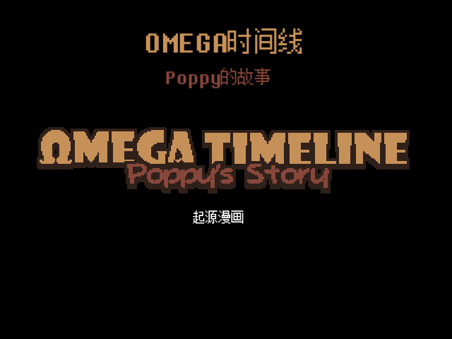

《Poppy的诞生》

<u>你可以在这里找到它。</u>（内容见下方的图库）

没错,伙计们,这是一部非常特别的漫画,它解答了一个由来已久却无人问津,但我一直想解答的问题:Poppy究竟从何而来?

更多漫画可能正在创作中,但现在,先看看这篇吧。

如果你是第一次认识Poppy,一定要去看看博客和提问时间轴!

## **图库**

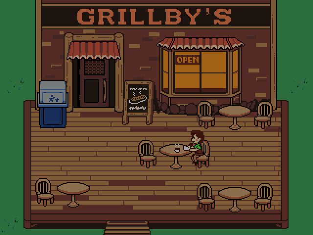

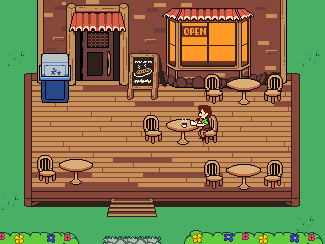

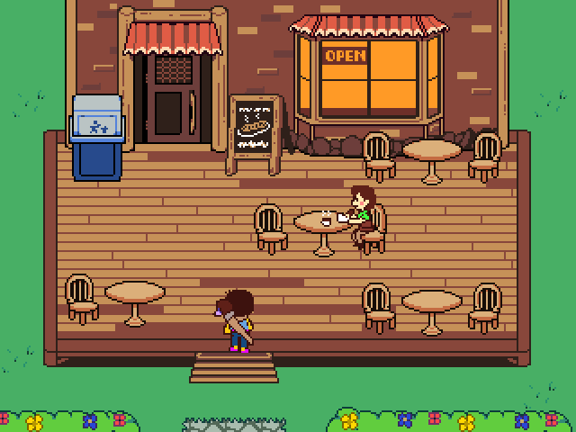

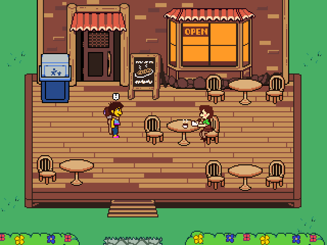

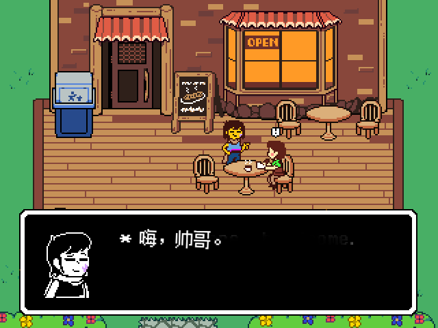

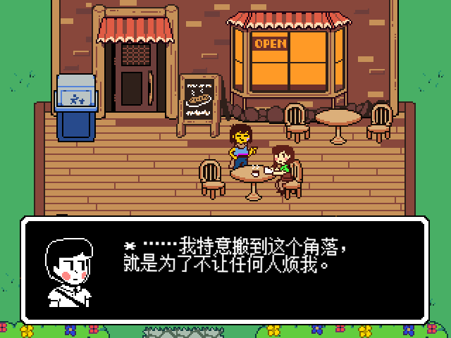

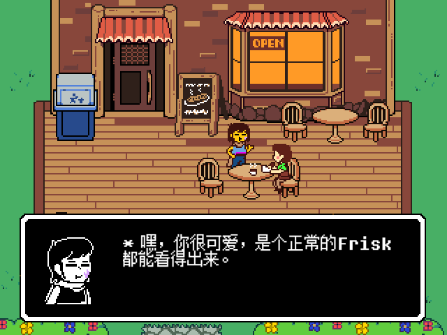

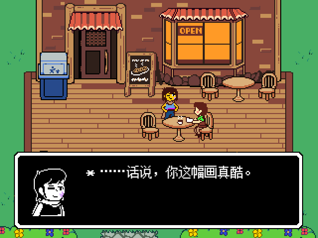

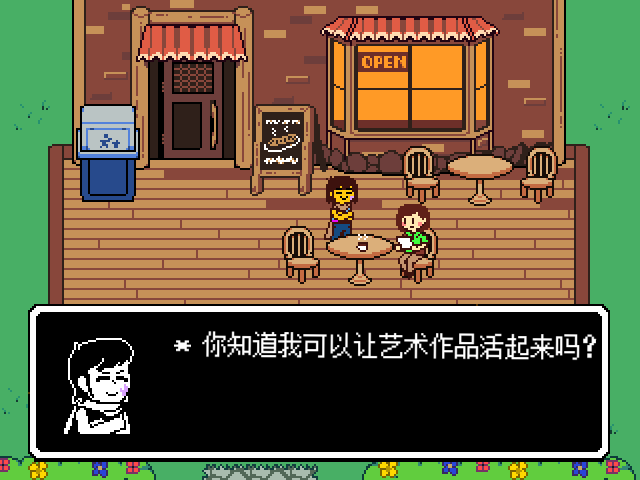

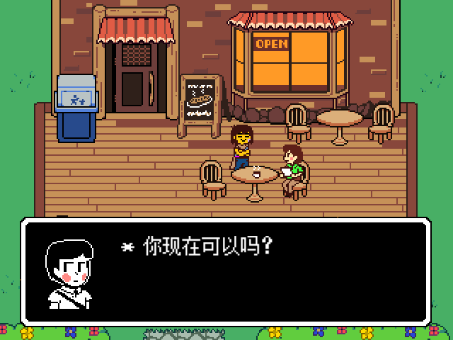

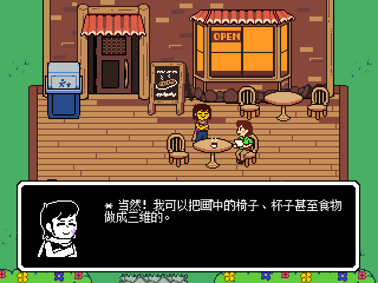

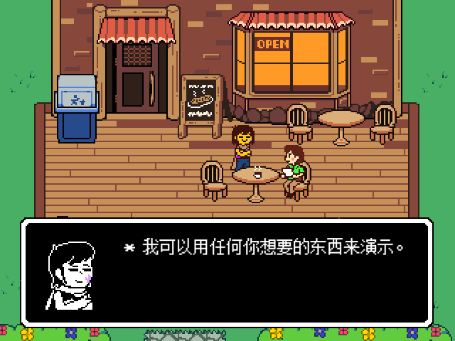

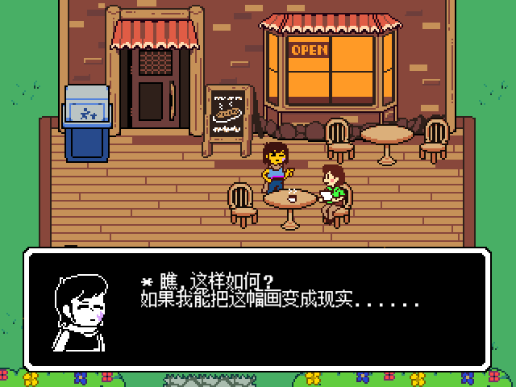

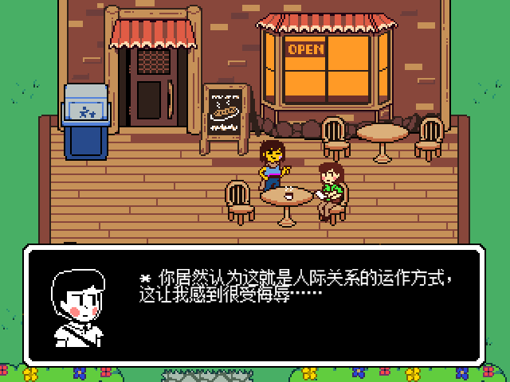

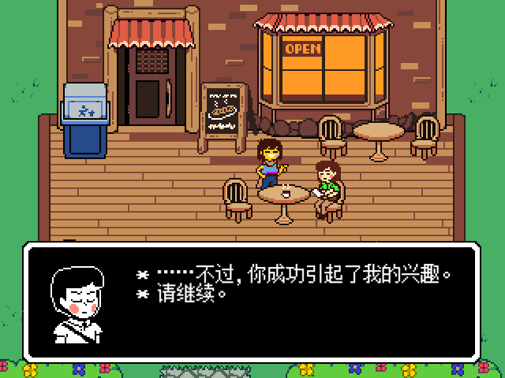

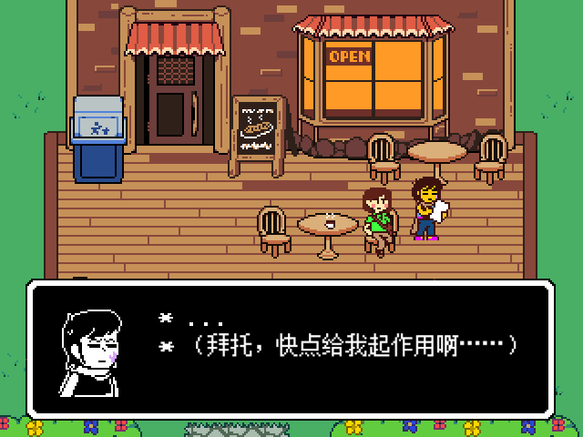

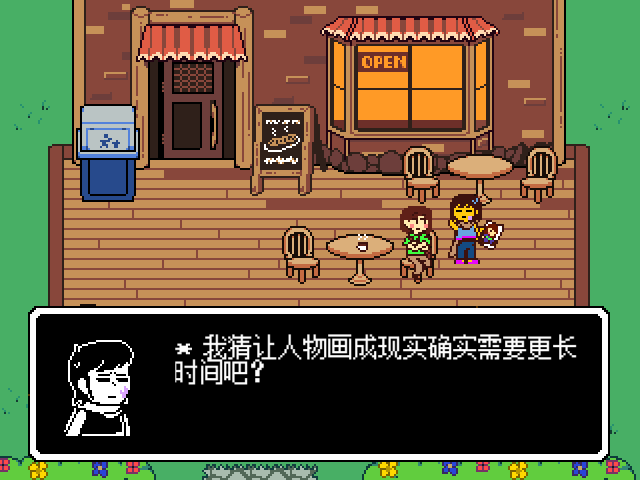

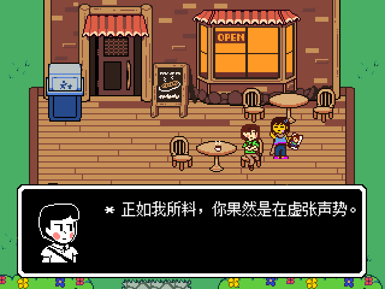

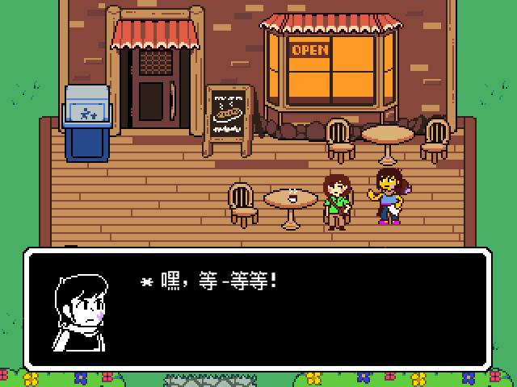

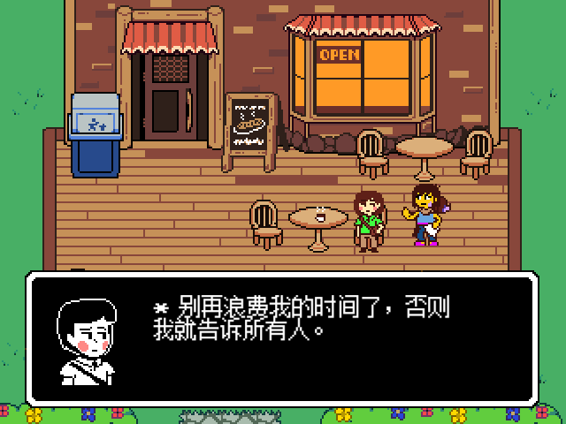

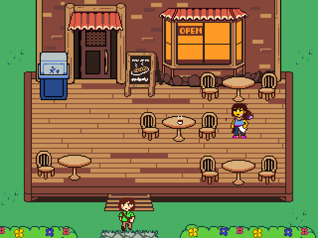

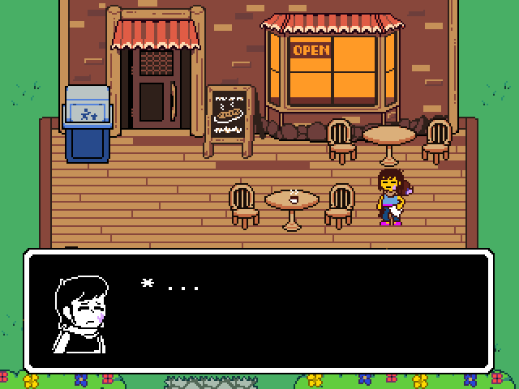

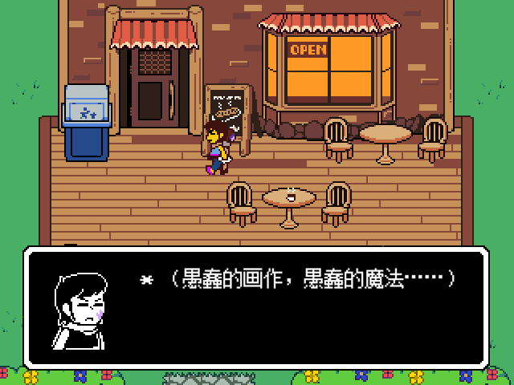

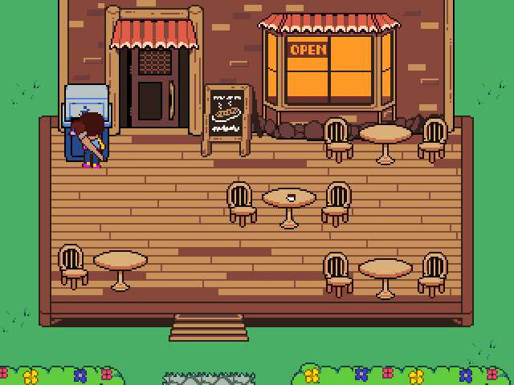

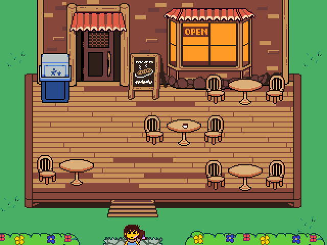

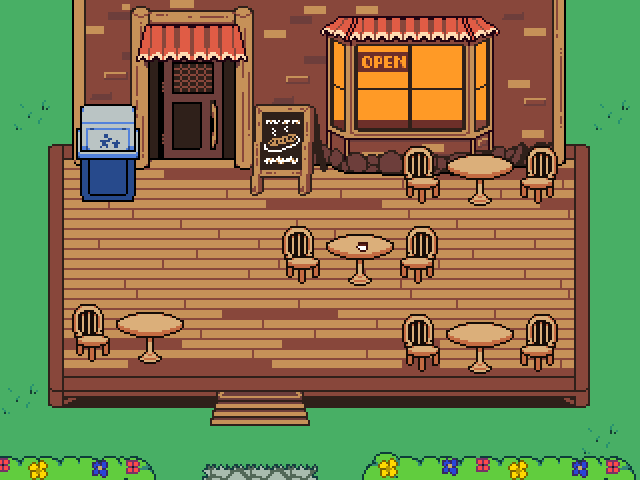

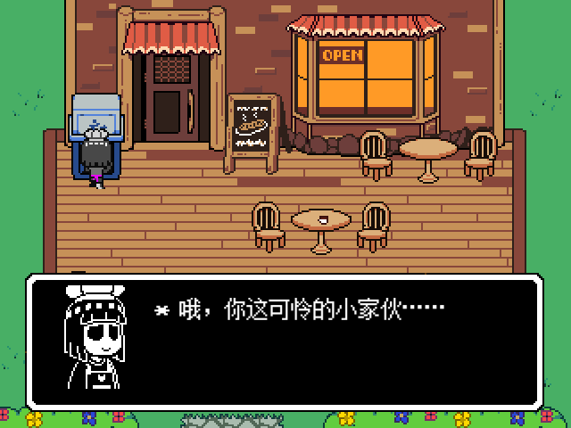

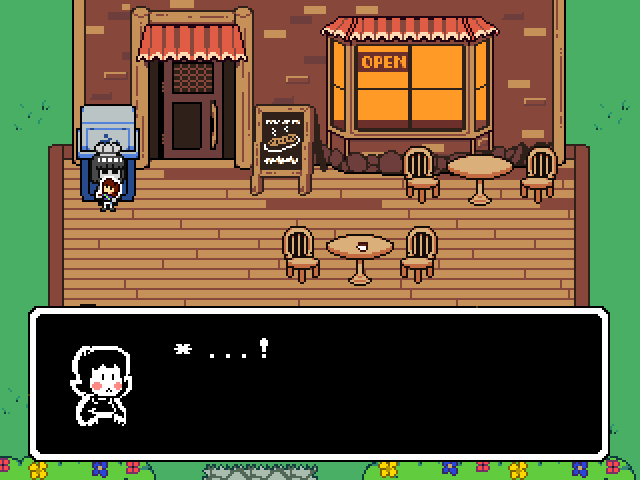

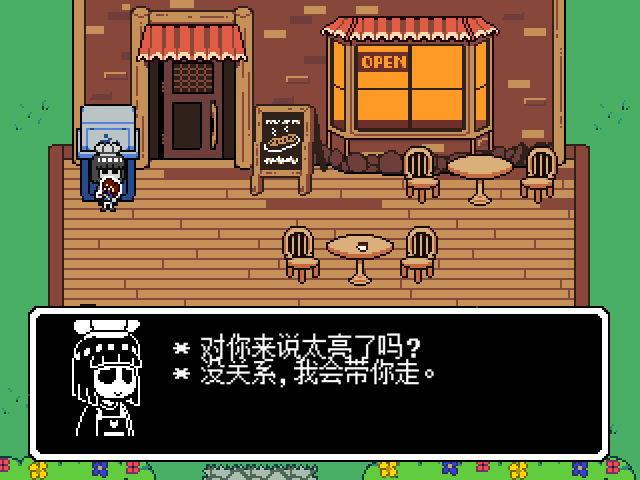

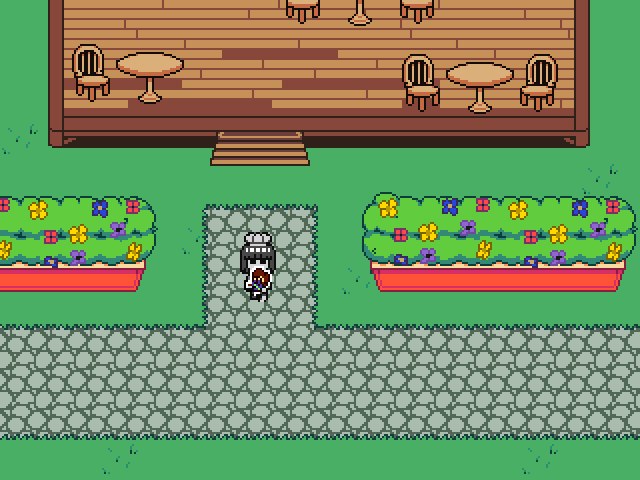

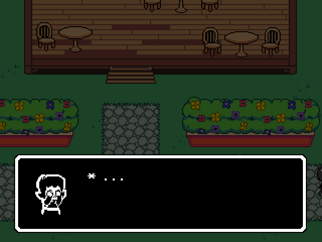

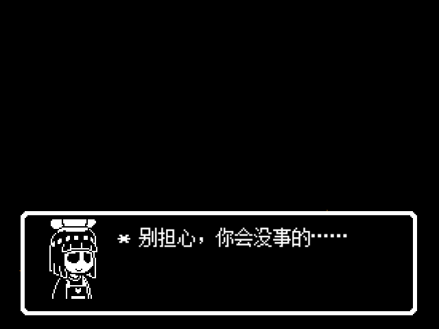