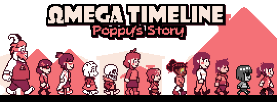
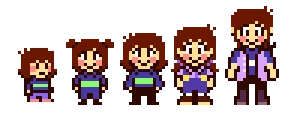
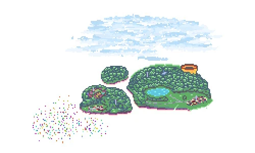

# [Undertale AU系列]Omega Timeline: Poppy's Story简介

> B站专栏版: https://www.bilibili.com/read/cv52524278

# **前言**

本文译自Omega Timeline: Poppy's Story官方Tumblr上发布的项目简介，[https://ut-poppy-askblog.tumblr.com/post/659815581864869888/image-welcome-to-omega-timeline-poppys](https://ut-poppy-askblog.tumblr.com/post/659815581864869888/image-welcome-to-omega-timeline-poppys)。

（值得注意的是：虽然tumblr无法直接访问，但是在github开发者syeopite的开源项目priviblur的帮助下，国内也可以正常访问tumblr。无法科学上网的请用该链接，国内可正常访问：“[https://priviblur.pussthecat.org/ut-poppy-askblog/post/659815581864869888/image-welcome-to-omega-timeline-poppys](https://priviblur.pussthecat.org/ut-poppy-askblog/post/659815581864869888/image-welcome-to-omega-timeline-poppys) ”。在此再次感谢github项目priviblur和开发者syeopite。）

原文投稿于2021年8月18日上午9点12分。

（本文是在▶ [@殉道寻路 大佬的专栏](https://www.bilibili.com/opus/967904419559505922) 的基础上去除人名、地名翻译而成）

【如果你有条件，可以去官方博客向该AU中可提问角色提问（虽然目前为止，该au已停止对提问的回应），但需要注意以下规则（该部分翻译来自该au的ask rules，链接为[https://ut-poppy-askblog.tumblr.com/ask-rules](https://ut-poppy-askblog.tumblr.com/ask-rules) ）：

1. 这一点不言而喻，但请不要发送不适宜公开的问题。

2. 请不要询问角色是否曾与[X AU角色]（这里指的应该是XTale的角色）见过面，或在Omega时间线中见过他们。

3. 通常要避免打破第四面墙的提问。随意提及AU中的名称对你没有任何帮助，因为除了CORE!Frisk之外没人会知道这些名称。所以请不要这样做。

4. 尽量不要问太多打破第四面墙的问题。我的意思是，偶尔问一两个没问题，但也没必要每隔几秒钟就问一句“你们的世界不是真实的”。

同时，上方国内可访问网站不支持登录注册tumblr账号，因此你无法通过该网站直接向该au中可提问角色提问，有条件的请还是访问官方tumblr网站注册、登录并提问

】

# **正文**

欢迎您，潜在的读者，来到本博客！

## **重要的链接：**

 [故事目录](story/故事目录.md)①| 常见问题 | 人物简介 | Omega时间线设定② | 官方Discord

 [第一幕提问时间轴](ask/act1/第一幕提问时间轴.md)③ | 第二幕提问时间轴

第一幕音乐集 | 第二幕音乐集

(以上音乐集的链接均为“[https://soundcloud.com/fmswhomakesmusic/sets/thypoppyost](https://soundcloud.com/fmswhomakesmusic/sets/thypoppyost) ”)

**【[我们会在缓慢更新故事的同时研发同人游戏]**(https://ut-poppy-fangame.tumblr.com/)

可提问角色：

- Cadence

- Poppy

- CORE!Frisk

- UC!Frisk

- Mr. Asgore

- Marlette

- ucans

- Hui

- Fasha

分割线④下方是项目简介⑤！
---

## **什么是《Omega时间线：Poppy的故事》？**

《Omega时间线：Poppy的故事》（别名《提问Poppy》）是一个设定在所谓的“Omega时间线”的日常向⑥故事，这条时间线由CORE!Frisk创建于一片白色虚空中，是灭族幸存者与危亡时间线民众的避风港，也可以是那些并不一定身处危险之人的放松去处。

故事将围绕Poppy Marusina，也就是CORE!Frisk的养孙女而展开，并会记录她在Omega时间线的日常生活、她的家人，以及在一个非常容易撞脸的地方生活⑦所发生的事情。如果一个人的故事被众多悲剧围绕着，那么它又怎能不融入其他人的故事呢？

这是个问答博客！意思是你可以通过提问的方式看到角色们的反应。我们也为此制作着尚未完结的故事，你可以在故事专栏里进行阅读。

## **什么是Omega时间线？**

Omega时间线（作者dokudoki）是于数千年前搭建的避风港，用于收留那些无家可归的人，但也不独属于他们；没有这些经历的人也经常来到这里休憩与放松。

[如果你希望了解更多有关Omega时间线的信息，你可以查阅Doku本人编写的这则AU维基条目！](https://undertale-au.fandom.com/wiki/Omega_Timeline )

请牢记本博客所展现的Omega时间线并非它的标准版本⑧或最终版本！

关于这一方面，Omega时间线并没有绝对的标准版本，你可以在自己的作品中任意解读它。

# **译注**

①原文为Masterpost，维基词典英文站将其定义为“汇集了有关同一主题的多则投稿的单个投稿”，此处根据Masterpost的内容而将其意译为“目录”。

②原文为Lore，牛津词典将其定义为“（尤指口头流传的）某一方面的学问；（某一群体的）传说，传统”，在同人创作社区中lore的内涵更接近于前者。此外Fandom的RPG Museum分区则将lore直接定义为“有关设定的公开信息，例如其地点、角色、生物及玄学规则”，故此处暂译为“设定”。

③原文为Chrono，是chronological（按时间顺序）的缩略形式。在Tumblr平台的个人账号标签检索链接后填入“/chrono”可以使检索结果按从新到旧的时间排序。

④原文为the cut。Tumblr平台的投稿可以自定义在账号内给用户显示的部分，相对地，被隐藏的内容则需要用户点击“展开阅读”的分割线来获取。

⑤原文为TL;DR，即too long; don't read（太长不读）的缩写。鉴于该词在原文中作为名词出现，其意义可延伸为“简介”或“省流版本”。

⑥原文为slice-of-life，在文艺作品领域内意为“反映现实生活的”，此处为简化定语而译为“日常向”。

⑦原文为living in a place with so many look-likes，其中look-alike在此意为“极为相像的人”，至于为什么会这么说，后面会考（其实联系前面所说的Omega时间线的设定也能猜得出来吧）。

⑧原文为canon，牛津词典将其定义为“原则；准则；标准”，而在同人创作社区中canon多指“被粉丝群体认为具有权威性的（资料）来源”（定义取自Fanlore），综合考虑后译为“标准”。鉴于该词在社区讨论中与official/官方/公式的含义存在一定重合，故canon对应的译文有时可能会直接写作“官方”。