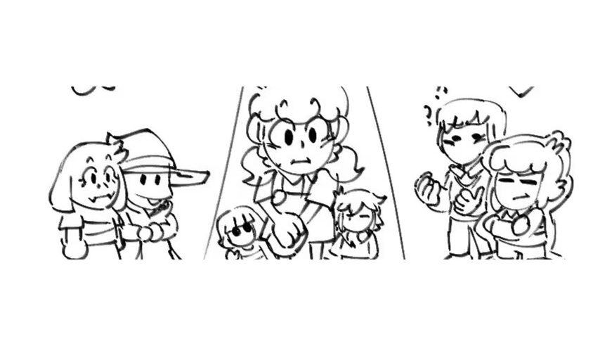

# [Undertale AU系列]Omega Timeline: Poppy's Story转载翻译序

> 原文: https://www.bilibili.com/read/cv52038217

> Omega Timeline: Poppy's Story（又名Ask Poppy）是一部以所谓的Omega Timeline为背景的生活片段型故事，这条时间线由CORE!Frisk在一片白色虚空之中创建，是灭族幸存者与危亡时间线民众的避风港，也可以是一般人的放松去处。

> 这个故事将围绕Poppy Marusina，也就是CORE!Frisk的养孙女而展开，并会记述她在Omega Timeline的日常生活，她的家人，以及在一个非常容易撞脸的地方生活所发生的事情。如果一个人的故事被众多的悲剧围绕着，那么它又怎能不融入他人的故事之中呢？

> ——FmsDraws（该AU系列作者）

致正在阅读本文的各位读者，你们好。

如果你能看见该专栏，那么你一定是Undertale的热爱粉，可能了解过（包括但不限于）Underverse等同人作品，并在这些作品（如▶ [【UNDERVERSE 0.6/中文字幕】[By Jakei]](https://www.bilibili.com/video/BV14Q4y1U7tE)）中见到Core!Frisk（及ta的Omega时间线）的身影。对于Core!Frisk这个AU角色，在国内外的Undertale圈子都相当有名，但作为Omega时间线的原住民、Core!Frisk的养孙女——Poppy，情况却截然不同：在国内圈子内鲜为人知，在国外圈子内知者甚众。而该AU又是Poppy这个角色诞生的AU，因此，今后若有空的话，我会将该系列翻译后转载至哔哩哔哩平台。

因此，本专栏作者将依靠前人的成果继续翻译该AU。

> 在此，我必需郑重向 [@殉道寻路](https://space.bilibili.com/3493129049082802)与 [@404-is-found](https://space.bilibili.com/506540227)两位大佬致以最诚挚的歉意。本专栏的后续翻译工作，虽出于对该AU的喜爱与分享热忱，但未经二位事先明确许可便直接承接前人之绪论，此间若有任何冒犯、越界或令二位感到不适之处，全然是我个人思虑不周之过。我深知每一份转载与翻译皆凝结着译者的心血与选择，我的后续行为无论有意无意，都可能对二位已付出的努力形成某种“覆盖”或“干扰”，这绝非我本愿。

> 若二位大佬认为我的翻译立场、行文态度、转载方式或任何相关举措有失妥当，或单纯不愿见该系列以他人笔触继续延伸，请务必不吝赐教——您可通过B站私信随时联系我，每一则消息我都会认真阅读、诚恳反思。只要您提出要求，无论是指出问题、协商调整，还是直接要求我删除全部已发布内容，我将无条件配合执行，绝无半点推诿或拖延。

> 我的初心始终是尊重每一位先行者，也尊重这个AU本身。

本专栏作者翻译将保留人名、地名，不对任何人名、地名做任何翻译但grandpa与sibling两者必须翻译且难翻译，因此将按照[@殉道寻路](https://space.bilibili.com/3493129049082802)大佬在

📄 [【Omega Timeline: Poppy's Story|翻译笔记】写在转载之前](https://www.bilibili.com/opus/933227618165063696)

中一、(7)进行翻译（即分别翻译成“族亲”和“同胞”，至于理由，请看这位大佬的专栏）

我个人对汉英文学乃至语言文字运用的掌握程度并不算高，翻译时难免会因自身能力所限而出现诸多错漏。还请各位读者与大佬（包括上文提到的两个大佬）批评指正。

本文及所有后续转载翻译该AU系列的专栏所用的所有插图均来自Omega Timeline: Poppy's Story的官方Tumblr博客，并且均由项目作者FmsDraws绘制。

此外，如果想简要了解一下该au系列的情况，本专栏作者建议看一下由该au作者制作的简要介绍视频——

▶ [[比较合格的熟肉]Omega时间线: Poppy的故事 - Undertale AU简要说明](https://www.bilibili.com/video/BV1zATt68EJj)

